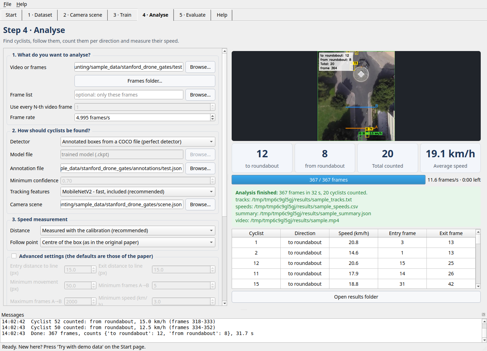
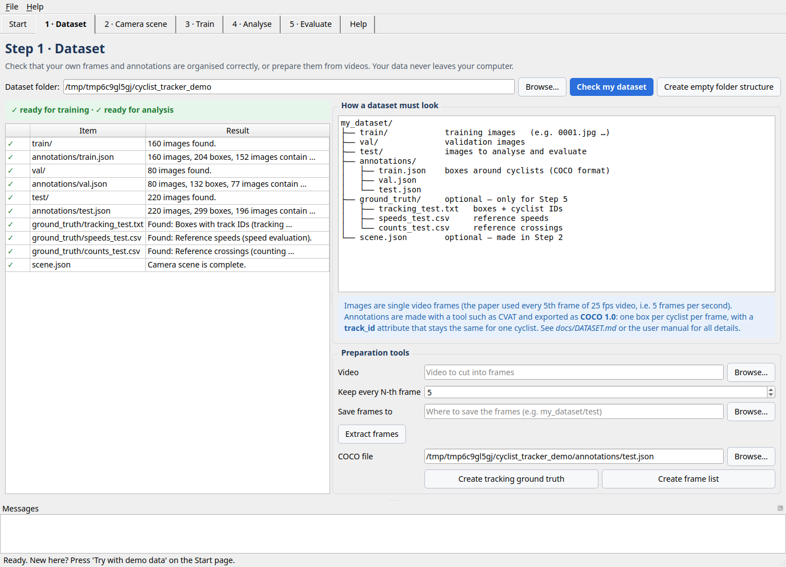
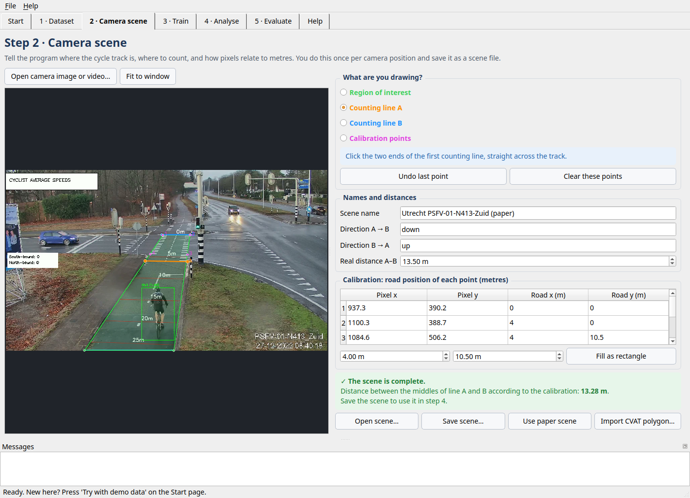
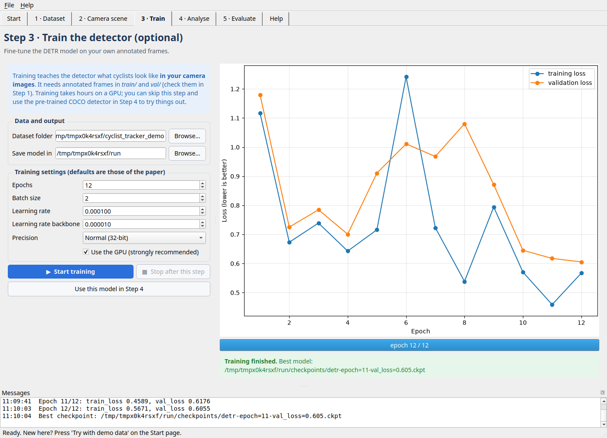
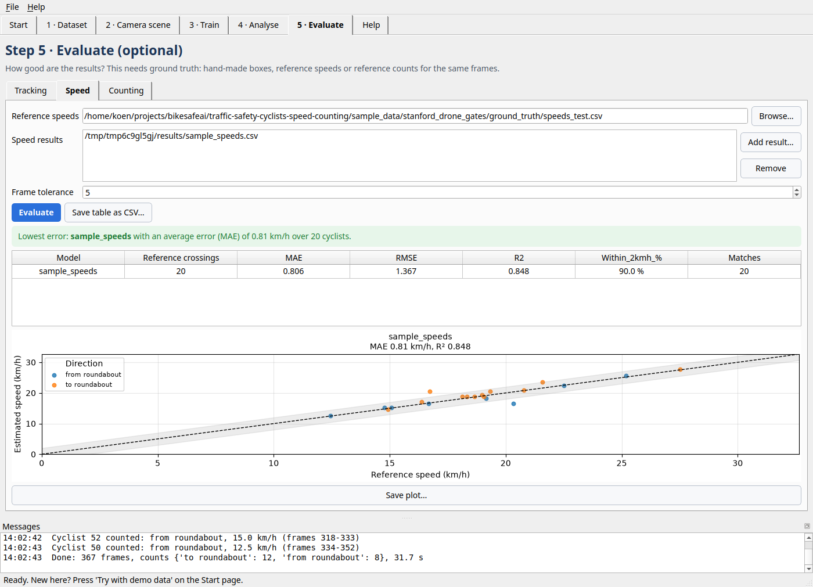

# Cyclist Tracker — vision-based cyclist counting and speed estimation

Cyclist Tracker finds cyclists in traffic-camera video, follows every cyclist over time, counts how many pass in
each direction and estimates their speed in km/h. It combines a **DETR** detector, the **DeepSORT** tracker and a
**homography** calibration that converts pixels into metres on the road.

The software comes with a **desktop application (PyQt6)** for non-technical users, a **command-line interface**
for automation, and a test suite with unit, integration and system tests.



This repository builds on the research of Avishkar Borkar,
*Vision-Based Cyclist Counting, and Speed Estimation Using Homographic Calibration* ([paper.pdf](paper.pdf)),
carried out at the NHL Stenden Lectoraat Computer Vision & Data Science within the
[BikeSafeAI](#acknowledgements) project. The original research code was restructured into an installable package,
several bugs were fixed and the graphical interface was added.

| Document | Content |
|---|---|
| [docs/user_manual.pdf](docs/user_manual.pdf) | Illustrated step-by-step guide to the desktop application |
| [docs/DATASET.md](docs/DATASET.md) | How to structure your own dataset and what it must contain |
| [sample_data/stanford_drone_gates](sample_data/stanford_drone_gates) | A real sample dataset in that structure (non-commercial licence) |
| [paper.pdf](paper.pdf) | The research paper with the method and results |

---

## Contents

1. [What it does](#what-it-does)
2. [Installation](#installation)
3. [Quick start](#quick-start)
4. [Using your own data](#using-your-own-data)
5. [The desktop application](#the-desktop-application)
6. [Command-line interface](#command-line-interface)
7. [Reproducing the paper](#reproducing-the-paper)
8. [Tests](#tests)
9. [Project structure](#project-structure)
10. [Changes compared to the original research code](#changes-compared-to-the-original-research-code)
11. [License, citation and acknowledgements](#license-citation-and-acknowledgements)

---

## What it does

```
video / frames ──► Detect (DETR) ──► Track (DeepSORT) ──► Count (lines A and B) ──► Speed (homography)
```

1. **Detect** – a DETR model fine-tuned on cyclists finds every cyclist in a frame. Detections outside the
   *region of interest* around the cycle track are ignored.
2. **Track** – DeepSORT links detections of the same cyclist in consecutive frames using motion (Kalman filter)
   and appearance features (MobileNetV2, OSNet or CLIP) and gives each cyclist an ID.
3. **Count** – a cyclist is counted once it has passed both counting lines, A and B. The order gives the direction.
   Cyclists that turn off or enter halfway are not counted.
4. **Speed** – four or more road points with known positions define a homography. The positions where the cyclist
   passed line A and line B are converted to metres; distance divided by time gives the speed.

Results are written as an annotated video, a tracking file, a CSV with one row per counted cyclist (direction,
speed, entry and exit frame) and a JSON summary.

## Installation

The project uses [uv](https://docs.astral.sh/uv/) for Python and all dependencies — no conda or manual
virtual environment is needed.

**1. Install uv** (once per computer)

```bash
# Linux and macOS
curl -LsSf https://astral.sh/uv/install.sh | sh
# Windows (PowerShell)
powershell -ExecutionPolicy ByPass -c "irm https://astral.sh/uv/install.ps1 | iex"
```

**2. Download the code and install**

```bash
git clone https://github.com/imaihub/traffic-safety-cyclists-speed-counting.git
cd traffic-safety-cyclists-speed-counting
uv sync
```

`uv sync` installs the right Python version (3.12) and all packages into a local `.venv` folder. On Linux and
Windows it installs PyTorch with CUDA 12.8 support; on macOS the standard build (CPU / Apple Metal).

**3. Check the installation**

```bash
uv run cyclist-tracker check
```

This shows the Python, PyTorch and GPU information. A GPU is not required, but analysis and especially training
are much faster with an NVIDIA GPU (8 GB or more for training).

**Optional feature extractors.** MobileNetV2 is included. OSNet (best tracking in the paper) and CLIP need an extra:

```bash
uv sync --extra torchreid     # OSNet-AIN
uv sync --extra clip          # CLIP ViT-B/32
```

The first analysis downloads the pre-trained DETR weights (about 200 MB) from Hugging Face.

| Requirement | Minimum | Recommended |
|---|---|---|
| Operating system | Windows 10/11, Linux, macOS | Ubuntu 22.04+ |
| RAM | 8 GB | 16 GB |
| GPU | – (CPU works, slowly) | NVIDIA, ≥ 8 GB VRAM, driver for CUDA 12.8 |
| Disk | 5 GB | 10 GB + your data |

## Quick start

```bash
uv run cyclist-tracker-gui
```

On the **Start** page press **Open sample dataset** (real drone footage, see below) or **Try with demo data** (a
synthetic dataset with known speeds). Either one fills in every tab and lets you run a complete analysis in seconds. The [user manual](docs/user_manual.pdf)
walks through all steps with screenshots.

The same from the command line:

```bash
uv run cyclist-tracker demo demo_data
uv run cyclist-tracker analyze demo_data/test --scene demo_data/scene.json \
    --detector annotations --annotations demo_data/annotations/test.json --output-dir results
uv run cyclist-tracker evaluate speed --gt demo_data/ground_truth/speeds_test.csv --pred results/analysis_speeds.csv
```

## Using your own data

The dataset of the paper (traffic cameras in Utrecht) is private and not included. You can use your own camera
footage. What you need depends on what you want to do:

| Goal | You need |
|---|---|
| Count cyclists and estimate speeds | Video or frames of one fixed camera + a *scene file* (made in the GUI) + a detector |
| Train a detector for your camera | Frames with boxes around cyclists (COCO format) for training and validation |
| Measure the quality | Ground truth for test frames: boxes with track IDs, reference speeds and/or reference counts |

A detector can be (1) a model trained with this software, (2) the pre-trained COCO DETR, which needs no training
at all (a *bicycle* box joined with its rider), or (3) your annotated boxes, used as perfect detections.

The expected folder structure:

```
my_dataset/
├── train/            training frames (.jpg / .png)
├── val/              validation frames
├── test/             frames to analyse and evaluate
├── annotations/
│   ├── train.json    COCO boxes, one per cyclist per frame, with a track_id attribute
│   ├── val.json
│   └── test.json
├── ground_truth/     optional, for evaluation
│   ├── tracking_test.txt   frame,track_id,x,y,w,h,conf,class,visibility
│   ├── speeds_test.csv     track_id,speed_kph,direction,crossing_time_sec,frames_taken,entry_frame,exit_frame
│   └── counts_test.csv     track_id,direction,frames_taken,entry_frame,exit_frame
└── scene.json        camera configuration (region, lines, calibration)
```

### Sample dataset

[`sample_data/stanford_drone_gates`](sample_data/stanford_drone_gates) is a small **real** dataset in exactly this
structure, to use as a reference: 73 seconds of drone video of a campus road with a roundabout from the
[Stanford Drone Dataset](https://cvgl.stanford.edu/projects/uav_data/), with the original hand-made annotations of
53 cyclists, reference speeds and crossings for 20 of them, a scene file and settings (22 MB). Train, validation
and test frames come from three different videos.

> The sample is licensed **CC BY-NC-SA 3.0 (non-commercial)** by the dataset authors — not AGPL like the code.
> See its [README](sample_data/stanford_drone_gates/README.md) and [LICENSE](sample_data/stanford_drone_gates/LICENSE.md).

With the annotated boxes as detections, 19 of 20 cyclists are counted correctly with an average speed error of
0.8 km/h. The camera looks straight down, which is why its `settings.json` follows the box centre. The sample is
rebuilt with `docs/tools/make_sdd_sample.py`; `docs/tools/download_sdd_videos.py` downloads single videos of the
71 GB dataset.

**See [docs/DATASET.md](docs/DATASET.md)** for the full description: frame rate and naming, annotation rules,
how to export from CVAT, how to split the data, how to measure calibration points and how to create each
ground-truth file. `uv run cyclist-tracker dataset validate my_dataset` (or *Check my dataset* in the GUI) tells
you in plain language what is missing.

## The desktop application

Start it with `uv run cyclist-tracker-gui` (or `uv run cyclist-tracker gui`). Each step of the workflow has a tab:

| Tab | What you do there |
|---|---|
| **Start** | Overview of the workflow, a check of your computer (GPU, optional packages) and the demo-data button |
| **1 · Dataset** | Check the folder structure and annotation files; cut videos into frames; create tracking ground truth and frame lists from COCO files |
| **2 · Camera scene** | Click the region of interest, counting lines A and B and the calibration points on a camera image; enter real distances; save as `scene.json` |
| **3 · Train** | Fine-tune DETR on your annotated frames with a live loss curve; hand the best model to step 4 |
| **4 · Analyse** | Choose video/frames, detector, tracking features and speed method; watch the live preview, counters per direction and a table of counted cyclists |
| **5 · Evaluate** | Tracking metrics (IDF1, MOTA, …), speed errors (MAE, RMSE, R², scatter plot; several results side by side) and counting accuracy (TP/FP/FN, F1) |
| **Help** | Glossary, common problems and the user manual |

| | |
|---|---|
|  |  |
|  |  |

## Command-line interface

All functions are available as `uv run cyclist-tracker <command>`; add `-h` to any command for all options.

| Command | Purpose |
|---|---|
| `gui` | Open the desktop application |
| `check` | Show Python / PyTorch / GPU information |
| `demo FOLDER` | Create the synthetic demo dataset |
| `dataset validate FOLDER` | Check a dataset and explain problems |
| `dataset init FOLDER` | Create the empty folder structure |
| `dataset extract-frames VIDEO OUT --every 5` | Save every 5th frame (25 fps → 5 fps) |
| `dataset coco-to-mot COCO OUT` | Tracking ground truth from a COCO file with `track_id` attributes |
| `dataset frame-list COCO OUT` | List of annotated frames |
| `dataset flatten COCO OUT --split test` | Rewrite `file_name` entries to `test/<image>` |
| `scene check FILE` / `scene paper OUT` | Check a scene file / write the scene of the paper |
| `train --dataset FOLDER` | Fine-tune the DETR detector |
| `analyze SOURCE --scene FILE` | Detect, track, count and measure speeds |
| `evaluate tracking/speed/counting` | Compare results with ground truth |

**Analyse a video** (every 5th frame of a 25 fps video, fine-tuned model):

```bash
uv run cyclist-tracker analyze camera.mp4 --stride 5 --scene scene.json \
    --detector checkpoint --checkpoint runs/detr/checkpoints/best.ckpt \
    --embedder mobilenet --output-dir results --name camera1
```

**Analyse a folder of frames without a trained model** (pre-trained COCO detector):

```bash
uv run cyclist-tracker analyze my_dataset/test --fps 5 --scene my_dataset/scene.json --detector coco
```

**Train** (settings of the paper are the defaults):

```bash
uv run cyclist-tracker train --dataset my_dataset --output runs/detr --epochs 30 --batch-size 2
```

**Evaluate**:

```bash
uv run cyclist-tracker evaluate tracking --gt my_dataset/ground_truth/tracking_test.txt --pred results/camera1_tracks.txt
uv run cyclist-tracker evaluate speed --gt my_dataset/ground_truth/speeds_test.csv \
    --pred results/a_speeds.csv results/b_speeds.csv --names "MobileNet" "OSNet" --plot speeds.png
uv run cyclist-tracker evaluate counting --gt my_dataset/ground_truth/counts_test.csv --pred results/camera1_speeds.csv
```

Important analysis options:

| Option | Default | Meaning |
|---|---|---|
| `--detector` | `checkpoint` | `checkpoint` (fine-tuned .ckpt), `coco` (no training), `annotations` (COCO boxes as perfect detections) |
| `--embedder` | `mobilenet` | DeepSORT features: `mobilenet`, `torchreid` (OSNet), `clip_ViT-B/32`, `histogram` (no network) |
| `--speed-mode` | `homography` | `homography` measures the distance with the calibration; `fixed_distance` uses the known distance between the lines |
| `--tracking-point` | `bottom` | Point of the box that is followed: `bottom` (where the wheels touch the road) or `center` (as in the paper) |
| `--fps` | 5 or video fps ÷ stride | Frame rate of the processed frames — speeds depend on it |
| `--paper-settings` | off | Exactly the settings of the paper |
| `--settings FILE` | – | Load all settings from JSON (see `configs/`) |
| `--legacy-sort` | off | Sort frames alphabetically like the original code (only to reproduce old frame numbers) |

## Reproducing the paper

The scene and settings of the paper are included in `configs/`. To re-run the experiments on the original
frames (available to project members only):

```bash
uv run cyclist-tracker analyze <utrecht test frames> --frame-list <test_images_with_annotations_f.txt> \
    --scene configs/utrecht_paper_scene.json --settings configs/paper_settings.json --legacy-sort \
    --checkpoint <epoch=30-step=18879.ckpt> --embedder torchreid
```

Results of the paper (Tables 2 and 4). Recomputing them with this code from the saved prediction files of the
original experiments gives the same values to the reported precision, except OSNet R² (0.888) and MobileNetV3
RMSE (2.17), which differ in the third decimal. This check is an automated regression test
(`tests/integration/test_paper_reproduction.py`) that runs when the private files are present.

| Feature extractor | IDF1 ↑ | MOTA ↑ | Precision ↑ | Recall ↑ | MAE (km/h) ↓ | RMSE (km/h) ↓ | R² ↑ |
|---|---|---|---|---|---|---|---|
| CLIP ViT-B/32 | 71.9 % | 58.2 % | 78.2 % | 81.3 % | 1.47 | 2.20 | 0.885 |
| OSNet-AIN-x1.0 | 72.8 % | 58.6 % | 78.5 % | 81.4 % | 1.45 | 2.17 | 0.889 |
| MobileNetV3 | 71.9 % | 58.2 % | 78.2 % | 81.4 % | 1.44 | 2.18 | 0.888 |

Counting (manually verified, paper Table 3): 60 valid cyclists; 54–55 counted correctly, 5 false positives
(mopeds/scooters) for every feature extractor.

## Tests

```bash
uv sync --group dev
uv run pytest                    # everything (about 1 minute with a GPU)
uv run pytest -m "not slow"      # skip tests that download / run the neural networks
uv run pytest -m unit            # only the fast unit tests
uv run pytest --cov=cyclist_tracker
```

| Level | Folder | What is tested |
|---|---|---|
| Unit | `tests/unit` | geometry and homography, configuration files, the counting/speed state machine, file formats, metrics, dataset checks, checkpoint key conversion, tracker wrapper |
| Integration | `tests/integration` | the full pipeline on the synthetic dataset (counts, speeds against the true simulated speeds, tracking), video input, stop/progress callbacks, dataset tools, a short training run, loading the paper checkpoint, reproduction of the paper's tables |
| System | `tests/system` | the command line as a separate process (complete workflow) and the desktop application driven with `pytest-qt` (demo button, drawing a scene with the mouse, running and evaluating an analysis) |

Tests that need private files are skipped automatically when those files are absent. The sample dataset is tested as well (structure, ground truth and a full analysis). The GitHub Actions workflow
(`.github/workflows/tests.yml`) runs lint and all tests except `slow` on every push.

## Project structure

```
src/cyclist_tracker/
├── config.py        SceneConfig (camera geometry) and AnalysisSettings, stored as JSON
├── geometry.py      lines, polygons, boxes, homography
├── counting.py      entry/exit logic, direction and speed per cyclist
├── detection.py     DETR checkpoint loader and the three detectors
├── tracking.py      DeepSORT wrapper and feature extractors
├── pipeline.py      frame sources (folder / video) and the streaming analysis
├── evaluation.py    MOT metrics, speed metrics and plots, counting metrics
├── training.py      DETR fine-tuning with PyTorch Lightning
├── dataset.py       dataset validation and preparation tools
├── synthetic.py     demo dataset generator
├── io_formats.py    tracking and CSV file formats
├── cli.py           command-line interface
└── gui/             PyQt6 application (one module per tab)
configs/             scene and settings of the paper, recommended settings
sample_data/         real sample dataset (Stanford Drone Dataset excerpt, CC BY-NC-SA 3.0)
docs/                user manual, dataset guide, screenshots, tools to rebuild them
tests/               unit, integration and system tests
```

## Changes compared to the original research code

* **Installable package** with `uv`, one command-line entry point and no hard-coded paths; duplicated pipelines
  (three nearly identical tracking/speed scripts) merged into one tested implementation.
* **Model loading fixed** – the published code could not load the checkpoint of the paper with current
  `transformers` versions (renamed layers) and filtered on the wrong class index for newly trained single-class
  models, which produced zero detections. The loader now adapts the weights and detects the class layout.
* **Frame order fixed** – frames were sorted alphabetically, so `frame_10000` came before `frame_9995` and parts of
  sequences were processed out of time order. Frames are now sorted naturally (`--legacy-sort` keeps the old order).
* **Memory** – all annotated frames were kept in memory before writing the video (tens of GB for the test set);
  the video is now written while processing.
* **Direction labels** – the pipeline wrote `northbound/southbound` while the ground truth used `up/down`, so the
  speed evaluation could not match anything without manual editing. Direction names are now part of the scene.
* **Road-contact point** – optional tracking of the bottom-centre of the box, which lies on the road plane where
  the homography is valid (see the report and `--tracking-point`).
* **Training** – no interactive prompt at the end, fast dataset initialisation, dropout correctly enabled.
* **New**: desktop application, scene editor, dataset validator, real sample dataset, demo dataset, counting evaluation, pre-trained
  COCO detector option, test suite and CI.

## License, citation and acknowledgements

The software is licensed under the GNU Affero General Public License v3.0 — see [LICENSE](LICENSE). The sample
dataset in `sample_data/` has its own licence (CC BY-NC-SA 3.0, Stanford Drone Dataset).

If you use this work, please cite the paper:

```
A. Borkar, "Vision-Based Cyclist Counting, and Speed Estimation Using Homographic Calibration",
NHL Stenden Lectoraat in Computer Vision & Data Science, BikeSafeAI project.
```

### Acknowledgements

Research: Avishkar Borkar (supervisor: Maya Aghaei Gavari). Software restructuring and desktop application:
Koen Molenaar. NHL Stenden University of Applied Sciences, Lectoraat Computer Vision & Data Science.
This project is financially supported by Regieorgaan SIA (part of NWO) under the RAAK Publiek project BikeSafeAI.


