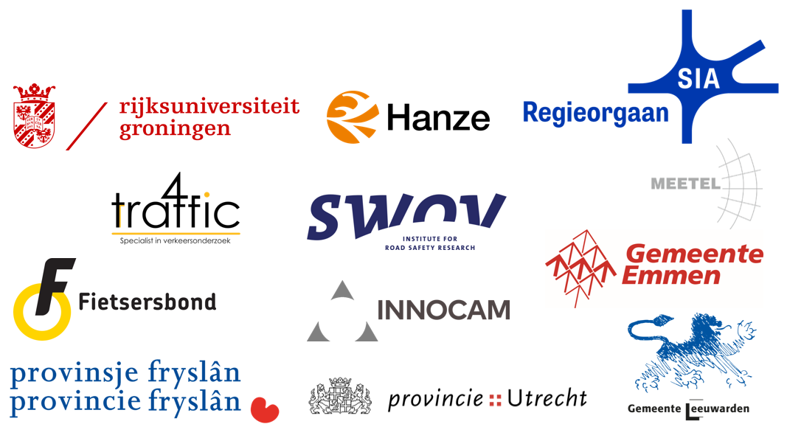

# Vision-Based Cyclist Counting, and Speed Estimation Using Homographic Calibration


**Author:** Avishkar Borkar

**Paper:** [paper.pdf](paper.pdf)

This project was developed as part of the BikeSafeAI project, which focuses on improving traffic safety for cyclists and other vulnerable road users. With cycling playing a major role in Dutch mobility, especially in busy urban areas and intersections, there is a growing need for reliable systems that can detect, track, count, and estimate the speed of cyclists.

Within this context, our work contributes a vision-based pipeline for cyclist counting and speed estimation. The system uses traffic video data to detect cyclists, follow them over time, and estimate their movement speed, supporting research into safer and smarter traffic monitoring solutions.

# Installation Guide

## 🛠 System Requirements

### Hardware
- **GPU**: NVIDIA GPU with ≥8GB VRAM (recommended for training)
- **RAM**: ≥16GB recommended
- **Disk**: ≥10GB free space

### Software
- **OS**: Linux (Ubuntu 24.04+) or Windows 10/11 with WSL2
- **CUDA**: tested with 12.8
- **cuDNN**: 8.x

# 📦 Detailed Setup

## 1. Python Environment

```bash
conda create -n myenv python=3.12.8 -y
conda activate myenv
```

## 2. Install PyTorch with CUDA

Install Torch-related packages build on CUDA 12.8 with the following command:

```bash
pip install torch==2.11.0 torchvision==0.26.0 torchaudio==2.11.0 --index-url https://download.pytorch.org/whl/cu128
```

## 3. Install Other Required Packages

```bash
pip install -r requirements.txt
```

## ✅ Verification

Run with the following code to confirm installation:

```bash
python verify.py
```

## Dataset

This project was developed and evaluated using a private traffic video dataset from Utrecht, the Netherlands.

The dataset cannot be redistributed with this repository due to privacy, ownership, and licensing restrictions.

To run the training and evaluation pipelines, users should provide their own dataset with a similar structure.

## Expected Dataset Structure

The code expects extracted image frames and annotation files. A recommended structure is:

```text
dataset/
├── train/
│   ├── image_000001.jpg
│   ├── image_000002.jpg
│   └── ...
├── val/
│   ├── image_000001.jpg
│   ├── image_000002.jpg
│   └── ...
├── test/
│   ├── image_000001.jpg
│   ├── image_000002.jpg
│   └── ...
├── annotations/
│   ├── training_set.json
│   ├── validation_set.json
│   └── testing_set.json
└── artifacts/
    ├── train_images_with_annotations.txt
    ├── val_images_with_annotations.txt
    └── test_images_with_annotations.txt
```
    
### Annotation Format

Annotations should contain object bounding boxes and track IDs for cyclists.

The original experiments used manually annotated frames created with CVAT, where each cyclist was assigned a unique track ID for multi-object tracking evaluation.

Each annotation entry should include at least:
- image/frame filename
- bounding box coordinates
- object class label, for example cyclist
- unique track ID, when tracking or speed estimation is used 

### Preparing Your Own Dataset

If you start from videos, first extract frames using the provided preprocessing scripts.

The original experiments extracted every 5th frame from 25 FPS videos, resulting in 5 FPS frame sequences.

Relevant dataset and preprocessing utilities include:
```text
elements/dataset_splits.py
elements/extract_frames_cyclists.py
elements/frames_from_folder_to_destination.py
elements/keep_valid_annotations.py
elements/flatten_json.py
```

After preparing the frames and annotations, update the paths in the training or inference commands:

```bash
PYTHONPATH=. python pipelines/training_pipeline.py \
    --train_dir dataset/train \
    --val_dir dataset/val \
    --test_dir dataset/test \
    --train_annotations dataset/annotations/training_set.json \
    --val_annotations dataset/annotations/validation_set.json \
    --test_annotations dataset/annotations/testing_set.json \
    --log_dir results \
    --epochs 30 \
    --batch_size 2 \
    --val_batch_size 4
```    
  
### Notes on Reproducibility

Because the original dataset is private, the exact reported metrics may not be reproducible from this repository alone.

However, the codebase can be used to train, evaluate, and run inference on similarly structured cyclist or traffic datasets.

### Dataset and Checkpoint Disclaimer

The dataset and trained checkpoints used in the original experiments are not included in this repository.

Users must provide their own dataset and update the paths in the commands accordingly.

When running the project, replace internal or local paths with your own dataset, checkpoint, and output paths.

For example, use paths such as:
```text
--frames-dir dataset/test
--checkpoint checkpoints/model.ckpt
--output-video results/tracking_output.mp4
``` 

instead of machine-specific paths such as:

```text
/path/to/dataset/test
```

# Training Detection Transformer

This guide provides instructions for training DETR (Detection Transformer) models on custom dataset.

## Training Detection Transformer 

```bash
PYTHONPATH=. python pipelines/training_pipeline.py \
    --train_dir /path/to/dataset/train \
    --val_dir /path/to/dataset/val \
    --test_dir /path/to/dataset/test \
    --train_annotations dataset/annotations/training_set_f.json \
    --val_annotations dataset/annotations/validation_set_f.json \
    --test_annotations dataset/annotations/testing_set_f.json \
    --log_dir results \
    --epochs 30 \
    --batch_size 2 \
    --val_batch_size 4 \
    --lr 1e-4 \
    --lr_backbone 1e-5 \
    --weight_decay 1e-4
```

## Parameters

| Parameter             | Description                  | Value                   |
|-----------------------|------------------------------|-------------------------|
| `--train_dir`         | Training dataset directory   | `/path/to/dataset`      |
| `--val_dir`           | Validation dataset directory | `/path/to/dataset`      |
| `--test_dir`          | Test dataset directory       | `/path/to/dataset`      |
| `--train_annotations` | Training annotations file    | `training_set_f.json`   |
| `--val_annotations`   | Validation annotations file  | `validation_set_f.json` |
| `--test_annotations`  | Test annotations file        | `testing_set_f.json`    |
| `--log_dir`           | Results output directory     | `BikeSafeAI/results`    |
| `--epochs`            | Number of training epochs    | `30`                    |
| `--batch_size`        | Training batch size          | `2`                     |
| `--val_batch_size`    | Validation batch size        | `4`                     |
| `--lr`                | Learning rate                | `1e-4`                  |
| `--lr_backbone`       | Backbone learning rate       | `1e-5`                  |
| `--weight_decay`      | Weight decay coefficient     | `1e-4`                  |


# BikeSafeAI Inference

## Overview

This repository contains inference scripts and evaluation metrics for the BikeSafeAI project, focusing on bicycle detection, tracking, and speed estimation using DETR (DEtection TRansformer) combined with DeepSort tracking.

## Demo: Cyclists Counting and Speed Estimation

### Objective
Compare the performance of different feature extractors integrated with DeepSort for object tracking in bicycle safety scenarios.

### Feature Extractors Tested
1. **CLIP (ViT-B-32)** - Vision Transformer based feature extraction
2. **MobileNet** - Lightweight CNN for mobile deployment
3. **OSNet** - Omni-Scale Network for person re-identification

### Model Variants
- **Base Models**: Trained with baseline configuration (epoch=30)

## Inference Scripts

### Base Models

#### 1. DETR + CLIP
```bash
PYTHONPATH=. python scripts/run_inference.py \
    --frames-dir "/path/to/dataset/test" \
    --annotations-list "dataset/artifacts/test_images_with_annotations_f.txt" \
    --checkpoint "/path/to/checkpoints/file" \
    --embedder "clip_ViT-B/32" \
    --embedder-weights "dataset/artifacts/ViT-B-32.pt" \
    --output-video "results/tracking_base_detr_mobilenet.mp4" \
    --output-file "results/predictions_DETR_deepsort_mobilenet_working.txt" \
    --pred-csv "results/predicted_base_mobilenet_speeds.csv" \
    --coords "649,748,1083,775,1127,239,1020,242" \
    --fps 10 \
    --progress-interval 50
```

#### 2. DETR + MobileNet
```bash
PYTHONPATH=. python scripts/run_inference.py \
    --frames-dir "/path/to/dataset/test" \
    --annotations-list "dataset/artifacts/test_images_with_annotations_f.txt" \
    --checkpoint "/path/to/checkpoints/file" \
    --embedder "mobilenet" \
    --embedder-weights "" \
    --output-video "results/tracking_base_detr_mobilenet.mp4" \
    --output-file "results/predictions_DETR_deepsort_mobilenet_working.txt" \
    --pred-csv "results/predicted_base_mobilenet_speeds.csv" \
    --coords "649,748,1083,775,1127,239,1020,242" \
    --fps 10 \
    --progress-interval 50
```

#### 3. DETR + OSNet
```bash
PYTHONPATH=. python scripts/run_inference.py \
    --frames-dir "/path/to/dataset/test" \
    --annotations-list "dataset/artifacts/test_images_with_annotations_f.txt" \
    --checkpoint "/path/to/checkpoints/file" \
    --embedder "torchreid" \
    --embedder-weights "" \
    --output-video "results/tracking_base_detr_osnet.mp4" \
    --output-file "results/predictions_DETR_deepsort_osnet_working.txt" \
    --pred-csv "results/predicted_base_osnet_speeds.csv" \
    --coords "649,748,1083,775,1127,239,1020,242" \
    --fps 10 \
    --progress-interval 50
```


## Experiment: Estimating Speeds of Cyclists

### Objective
To estimate the speeds of each individual cyclist tracked within the region of interest, simply run the same inference scripts used in the previous experiment.

> 💡 If the previous experiment has already been executed, you do not need to re-run any scripts for this experiment.

---

### Ground Truth Speeds Generation
Ground truth speeds are calculated only within a region whose real-world dimensions are known. The speed is computed based on pixel displacement over time, then translated into meters per second.

---

### Ground Truth Speed Script

```bash
PYTHONPATH=. python pipelines/generate_gt_speed_pipeline.py \
    --frames-dir "/path/to/dataset/test" \
    --annotations-list "dataset/artifacts/test_images_with_annotations_f.txt" \
    --checkpoint "/path/to/checkpoints/file" \
    --gt-output-csv "dataset/artifacts/gt_speeds_generated_from_pipeline.csv" \
    --output-video "results/gt_speed_visualization_video.mp4" \
    --polygon-coords "937,390,1100,388,1003,1080,469,1079" \
    --embedder "mobilenet" \
    --fps 5 \
    --progress-interval 50

```
### Predicted Speed Script

```bash
PYTHONPATH=. python pipelines/generate_homography_speed_pipeline.py \
    --frames-dir "/path/to/dataset/test" \
    --annotations-list "dataset/artifacts/test_images_with_annotations_f.txt" \
    --checkpoint "/path/to/checkpoints/file" \
    --pred-output-csv "results/predicted_homography_speeds.csv" \
    --output-video "results/homography_speed_visualization_video.mp4" \
    --homography-src-ref "937.30,390.20,1100.30,388.70,1084.60,506.20,862.40,504.00" \
    --homography-dst-ref "0,0,4,0,4,10.5,0,10.5" \
    --polygon-coords "937,390,1100,388,1003,1080,469,1079" \
    --embedder "mobilenet" \
    --fps 5 \
    --progress-interval 50
```


## Experiment : Counting Cyclists

### Objective
Count the number of cyclists passing through a defined region of interest using DETR detection capabilities.

### Implementation
The cyclist counting experiment uses a single configuration optimized for detection and counting rather than tracking individual objects over time.

If the previous experiment has already been executed, you do not need to re-run any scripts for this experiment.

The counts can be visualized in the generated outputs !

## Command Line Arguments

### Required Arguments
- `--frames-dir`: Directory containing test frame images
- `--annotations-test`: Path to test annotations JSON file
- `--annotations-list`: List of test images with annotations
- `--checkpoint`: Model checkpoint file path
- `--gt-csv`: Ground truth CSV file with speed data
- `--output-video`: Output video file path
- `--output-file`: Output text file for tracking results
- `--pred-csv`: Output CSV file for predicted speeds
- `--predictions`: Output predictions file
- `--coords`: Coordinate string for region of interest (format: "x1,y1,x2,y2,x3,y3,x4,y4")

### Optional Arguments
- `--embdr-wt`: Pre-trained embedding weights (required for CLIP and OSNet)
- `--fps`: Frames per second for output video (default: 10)
- `--progress-interval`: Progress reporting interval (default: 50)

## Output Files

### Generated Outputs
1. **Tracking Videos**: Visual representation of detection and tracking results
   - `tracking_base_detr_[extractor].mp4`

2. **Tracking Results**: Detailed tracking information in text format
   - `tracking_results_base_[extractor].txt`

3. **Speed Predictions**: CSV files containing predicted speeds
   - `predicted_base_[extractor]_speeds.csv`

4. **Prediction Files**: Complete prediction results
   - `predictions_DETR_deepsort_base_[extractor]_working.txt`


## Evaluation Metrics

### Key Performance Indicators
- **Tracking Performance**: MOTA (Multiple Object Tracking Accuracy), MOTP (Multiple Object Tracking Precision)
- **Speed Estimation**: MAE (Mean Absolute Error), RMSE (Root Mean Square Error)
- **Computational Efficiency**: FPS, inference time per frame


## Experiment: Feature Extractor Replacement with DeepSort

### Objective
Compare the performance of different feature extractors integrated with DeepSort for object tracking in bicycle safety scenarios.

### Evaluate Performance of Feature Extractors:

```bash
PYTHONPATH=. python pipelines/evaluation_pipeline_mot.py \
    --gt "dataset/artifacts/groundtruth_test_fullds.txt" \
    --pred "dataset/artifacts/predictions_mobilenet.txt" \
    --iou-threshold 0.5 \
    --output "dataset/results/mobilenetv3_eval.csv"

```
```bash
PYTHONPATH=. python pipelines/evaluation_pipeline_mot.py \
    --gt "dataset/artifacts/groundtruth_test_fullds.txt" \
    --pred "dataset/artifacts/predictions_clip_ViT-B32.txt" \
    --iou-threshold 0.5 \
    --output "results/mot_metrics_clip_custom.csv"
```
```bash
PYTHONPATH=. python pipelines/evaluation_pipeline_mot.py \
    --gt "dataset/artifacts/groundtruth_test_fullds.txt" \
    --pred "dataset/artifacts/predictions_osnet_ain_x1_0.txt" \
    --iou-threshold 0.5 \
    --output "results/mot_metrics_osnet_custom.csv"
```


## Experiment: Estimating Speeds of Cyclists
### Objective
To estimate the speeds of each individual cyclist tracked within the region of interest, simply run the same inference scripts used in the previous experiment.


### Evaluate MAE and RMSE of Predicted Speeds:

```bash
PYTHONPATH=. python pipelines/evaluation_pipeline_speed.py \
    --gt-csv "dataset/artifacts/gt_speeds_fullds.csv" \
    --pred-files \
        "dataset/artifacts/predicted_base_clip_speeds.csv" \
        "dataset/artifacts/predicted_base_osnet_speeds.csv" \
        "dataset/artifacts/predicted_base_mobilenetv3_speeds.csv" \
    --model-names \
        "Base CLIP" \
        "Base OSNet" \
        "Base MobileNet" \
    --output-dir "results/custom_speed_eval" \
    --frame-tolerance 3
```

| Argument            | Type        | Description                                                                      | Default                                               |
|---------------------|-------------|----------------------------------------------------------------------------------|-------------------------------------------------------|
| `--gt-csv`          | `str`       | (Required) Path to the ground truth CSV file                                     | `BikeSafeAI/dataset/artifacts/gt_speeds_fullds.csv`   |
| `--pred-files`      | `list[str]` | List of paths to prediction CSV files                                            | See list below                                        |
| `--model-names`     | `list[str]` | Display names for each model, used in plots and output                           | `["Base CLIP", "Base MobileNetV3", ..., "FTL OSNet"]` |
| `--output-dir`      | `str`       | Directory to save plots and evaluation results                                   | `results/speed_metrics`                               |
| `--frame-tolerance` | `int`       | Maximum number of frames for alignment between predicted and ground truth values | `5`                                                   |
| `--no-plots`        | `flag`      | Add this flag to skip plot generation                                            | `False` (plots generated by default)                  |


## Experiment: Evaluate Valid Counts of Cyclists
### Objective

Count the number of cyclists passing through a defined region of interest using DETR + DeepSort detection capabilities.

The ground truth with entry and exit frames of valid cyclists has been provided in the Dataset folder.

For this we manually verified the count of valid cyclists entering and exiting for the defined lines by watching the testing set.

# Metrics - Counting:

1. Valid Cyclists Observed → 60
2. False Positives(Mopeds/scooters) in predicted videos -> 5 For all 3 feature extractors
3. Missed predictions due to swerving or weather conditions -> CLIP: 6, OSNET: 6, MobileNET: 5

Please find the metrics table below: 

| Model | Feature Extractor | Detected Cyclists | TP | FP | Accuracy ↑ |
|-------|-------------------|-------------------|----|----|------------|
| DETR  | CLIP              | 59                | 54 | 5  | 91.5%      |
| DETR  | OSNet             | 59                | 54 | 5  | 91.5%      |
| DETR  | MobileNet         | 60                | 55 | 5  | 91.7%      |


# Metrics - Speed:

| Model | Feature Extractor | MAE ↓ | RMSE ↓ | R² ↑  |
|-------|-------------------|-------|--------|-------|
| DETR  | CLIP ViT-B32      | 1.47  | 2.20   | 0.885 |
| DETR  | MobileNetV3       | 1.44  | 2.18   | 0.888 |
| DETR  | OSNet-AIN-x1.0    | 1.45  | 2.17   | 0.889 |

# Metrics - REID Feature Extractors:
| Model | Feature Extractor | IDF1 ↑ |   | MOTA ↑ | Precision ↑ | Recall ↑ |
|-------|-------------------|--------|:--|--------|-------------|----------|
| DETR  | CLIP ViT-B32      | 71.9%  |   | 58.2%  | 78.2%       | 81.3%    |
| DETR  | OSNet-AIN-x1.0    | 72.8%  |   | 58.6%  | 78.5%       | 81.4%    |
| DETR  | MobileNetV3       | 71.9%  |   | 58.2%  | 78.2%       | 81.4%    |



## Results

1. Counting of Valid Cyclists


2. Estimating Speeds of Cyclists 


